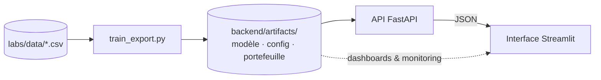

<div align="center">

# 🏦 Machine Learning pour le secteur bancaire

**Formation pratique destinée aux experts métier et IT de la banque — de la théorie au modèle déployé.**

[](https://www.python.org/)
[](https://scikit-learn.org/)
[](https://xgboost.ai/)
[](https://fastapi.tiangolo.com/)
[](https://streamlit.io/)
[](https://jupyter.org/)
[](LICENSE)

[Contenu](#-contenu) · [Démarrage rapide](#-démarrage-rapide) · [Labs](#-les-labs) · [Applications](#-les-applications) · [API](#-utiliser-les-api) · [Structure](#-structure-du-dépôt)

</div>

---

## 📌 Présentation

Ce dépôt réunit l'ensemble du matériel d'une formation **Machine Learning appliqué à la banque** :

- des **notions théoriques simplifiées** (IA, ML, Deep Learning, IA générative, MLOps) ;
- deux **labs complets**, corrigés, commentés et exécutés, sur des données publiques ;
- deux **applications déployables** (API FastAPI + interface Streamlit) qui industrialisent le modèle final de chaque lab : scoring, dashboard et monitoring de la dérive.

L'objectif : parcourir **tout le cycle de vie d'un modèle** — du cadrage métier jusqu'à la mise en production et au suivi — sur deux cas d'usage bancaires emblématiques.

## 📦 Contenu

| Livrable | Description |
|---|---|
| 📑 [`slides/main.pdf`](slides/main.pdf) | Support de cours LaTeX Beamer (~95 pages) |
| 📓 [`labs/lab1_credit_scoring.ipynb`](labs/lab1_credit_scoring.ipynb) | **Lab 1 — Classification** : credit scoring (German Credit) |
| 📓 [`labs/lab2_segmentation_clients.ipynb`](labs/lab2_segmentation_clients.ipynb) | **Lab 2 — Clustering** : segmentation client (Bank Marketing) |
| 🚀 [`apps/credit_scoring/`](apps/credit_scoring/) | API + interface : scoring, dashboard KPIs portefeuille, monitoring |
| 🚀 [`apps/segmentation/`](apps/segmentation/) | API + interface : affectation, dashboard segments, dérive |

## 🎓 Programme

| # | Module | Points clés |
|---|---|---|
| 1 | **Introduction** | IA, ML, Deep Learning, IA générative · apprentissage supervisé, non supervisé, par renforcement · cartographie des cas d'usage bancaires |
| 2 | **Cycle de vie & MLOps** | Cadrage, données, modélisation, validation, déploiement (architecture 3-tiers), monitoring (data/concept drift, PSI) · niveaux de maturité · contraintes bancaires (risque de modèle, RGPD, AI Act, FINMA) |
| 3 | **Apprentissage supervisé** | EDA, encodage, scaling, validation croisée, *data leakage* et pipelines · feature engineering et sélection de variables · régression logistique, KNN, arbre, Random Forest, XGBoost · ROC/AUC/Gini/KS, seuil par le coût métier, grille de risque · classes déséquilibrées · explicabilité et équité |
| 4 | **Clustering** | Distances, K-Means, choix de *k* et métriques internes, K-Prototypes (données mixtes), CAH et dendrogrammes, ACP · profilage et personas · industrialisation |
| 5 | **Labs, applications & conclusion** | Mise en pratique de bout en bout |

## ⚡ Démarrage rapide

**Prérequis :** Python 3.10+ et `pip`.

```bash
# 1. Cloner le dépôt
git clone https://github.com/bassambhamed/machine-learning-banking.git
cd machine-learning-banking

# 2. (Recommandé) Créer un environnement virtuel
python -m venv .venv
source .venv/bin/activate          # Windows : .venv\Scripts\activate

# 3. Installer les dépendances
pip install -r labs/requirements.txt
pip install -r apps/requirements.txt

# 4. Télécharger les jeux de données (une seule fois, accès Internet requis)
python labs/data/download_data.py
```

Les notebooks se lancent depuis le dossier `labs/` (chemins relatifs `data/...`) :

```bash
cd labs && jupyter lab
```

## 🧪 Les labs

### Lab 1 — Credit scoring

> **Données :** German Credit (UCI) — 1 000 demandes de crédit, 20 variables, 30 % de défauts.

Cadrage et matrice de coût · EDA · pipeline et démonstration du *leakage* · feature engineering · 5 modèles en validation croisée · sélection de variables (information mutuelle, RFECV, L1, permutation) · courbes de validation et d'apprentissage · GridSearch / RandomizedSearch · ROC, KS, précision-rappel · **seuil optimisé par le coût** · **grille de risque A → E** · odds ratios · équité · export, API, PSI.

| Modèle (optimisé) | AUC CV | AUC test |
|---|:---:|:---:|
| Random Forest | 0,799 | 0,812 |
| XGBoost | 0,793 | 0,809 |
| **Régression logistique (retenue)** | 0,779 | **0,802** (Gini 0,603) |
| KNN | 0,778 | 0,803 |
| Arbre de décision | 0,734 | 0,728 |

> 💡 La régression logistique est retenue : son écart avec le meilleur modèle (0,020) est inférieur à l'écart-type de la validation croisée, pour une **explicabilité bien supérieure** — un critère déterminant en contexte bancaire.

### Lab 2 — Segmentation client

> **Données :** Bank Marketing (UCI) — 45 211 clients, variables mixtes (âge, solde, métier, statut marital, études, crédits).

EDA et V de Cramér · Yeo-Johnson · K-Means (coude, silhouette, Davies-Bouldin, Calinski-Harabasz, ACP) · **K-Prototypes** (effet de γ) · CAH (Ward, distance de Gower) · comparaison et stabilité (ARI) · **profilage et personas** · affectation et dérive.

| Persona | Part du portefeuille | Souscription (lift) |
|---|:---:|:---:|
| 🏠 Familles propriétaires | 37 % | 9,0 % (0,77) |
| 🧓 Seniors | 28 % | 12,8 % (1,09) |
| 🚀 Jeunes actifs | 26 % | 14,1 % (1,21) |
| 💎 Patrimoniaux | 7 % | 15,2 % (1,30) |
| ⚠️ Clients fragiles | 3 % | 5,6 % (0,48) |

## 🚀 Les applications

Chaque application suit une **architecture 3-tiers** : un script d'entraînement reproduit la configuration finale du lab et exporte les artefacts, une API FastAPI les sert, une interface Streamlit les consomme.



### Lancement

```bash
# ── Credit scoring — API :8000, interface :8501 ──
cd apps/credit_scoring/backend
python train_export.py
uvicorn app:app --host 127.0.0.1 --port 8000
# dans un autre terminal
cd apps/credit_scoring/frontend
streamlit run app.py --server.port 8501

# ── Segmentation — API :8001, interface :8502 ──
cd apps/segmentation/backend
python train_export.py
uvicorn app:app --host 127.0.0.1 --port 8001
# dans un autre terminal
cd apps/segmentation/frontend
streamlit run app.py --server.port 8502
```

| Application | Interface | Documentation API |
|---|---|---|
| Credit scoring | http://127.0.0.1:8501 | http://127.0.0.1:8000/docs |
| Segmentation | http://127.0.0.1:8502 | http://127.0.0.1:8001/docs |

> ℹ️ Les API n'exposent pas de page racine : `GET /` renvoie `404`. Utilisez `/docs` pour explorer les endpoints.
> Les URL des API utilisées par les interfaces se configurent via `CREDIT_API_URL` et `SEGMENTATION_API_URL`.

### Fonctionnalités

| Application | Endpoints | Pages Streamlit |
|---|---|---|
| **Credit scoring** | `GET /health` · `GET /model-info` · `GET /schema` · `POST /predict` · `POST /predict-batch` | Scoring d'une demande (jauge, facteurs explicatifs, *what-if*) · Scoring par lot · Dashboard KPIs portefeuille · Performance & monitoring (ROC, coût/seuil, PSI) |
| **Segmentation** | `GET /health` · `GET /segments` · `GET /schema` · `POST /assign` · `POST /assign-batch` | Affecter un client (persona, offres) · Affectation par lot · Dashboard segments · Qualité & dérive (PSI) |

## 🔌 Utiliser les API

Les champs non renseignés prennent la valeur par défaut du portefeuille (mode ou médiane) ; les valeurs autorisées sont listées par `GET /schema`.

**Scorer une demande de crédit**

```bash
curl -X POST http://127.0.0.1:8000/predict \
  -H "Content-Type: application/json" \
  -d '{"duration": 24, "credit_amount": 3000, "age": 35, "purpose": "used car"}'
```

La réponse contient la probabilité de défaut, un score sur 1 000, la classe de risque (A → E), la décision (`Accepter` / `Revoir` / `Refuser`) et les principaux facteurs explicatifs.

**Affecter un client à un segment**

```bash
curl -X POST http://127.0.0.1:8001/assign \
  -H "Content-Type: application/json" \
  -d '{"age": 29, "balance": 850, "job": "technician", "marital": "single", "housing": "yes"}'
```

La réponse contient le segment, la persona, sa description, les offres recommandées et la proximité du client à chaque segment.

## 🗂 Structure du dépôt

```
machine-learning-banking/
├── slides/
│   └── main.pdf                      # support de cours
├── labs/
│   ├── data/download_data.py         # téléchargement des jeux de données
│   ├── models/                       # artefacts exportés par les notebooks
│   ├── lab1_credit_scoring.ipynb
│   ├── lab2_segmentation_clients.ipynb
│   └── requirements.txt
└── apps/
    ├── requirements.txt
    ├── credit_scoring/
    │   ├── backend/                  # features.py · train_export.py · app.py · artifacts/
    │   └── frontend/                 # app.py (Streamlit)
    └── segmentation/
        ├── backend/
        └── frontend/
```

## ⚠️ Avertissement

Ce projet a une vocation **pédagogique**. Les modèles sont entraînés sur des jeux de données publics anciens et ne doivent pas être utilisés pour des décisions réelles d'octroi de crédit ou de ciblage commercial. Toute mise en production dans un établissement bancaire exige une validation du risque de modèle, une analyse d'équité et une conformité réglementaire (RGPD, AI Act, exigences FINMA).

## 📚 Sources des données

- [German Credit (Statlog)](https://archive.ics.uci.edu/dataset/144/statlog+german+credit+data) — UCI Machine Learning Repository
- [Bank Marketing](https://archive.ics.uci.edu/dataset/222/bank+marketing) — UCI Machine Learning Repository

Les jeux de données sont distribués par l'UCI sous licence [CC BY 4.0](https://creativecommons.org/licenses/by/4.0/).

## 📄 Licence

Ce projet est distribué sous licence MIT — voir le fichier [`LICENSE`](LICENSE).
